# 📋 KeepTrack

> A clean, minimalist, and pastel-themed personal task manager and daily habit companion built with **Flutter**, **Firebase**, and **Riverpod**.

---

## 📸 Screenshots & UI Showcase

### 🏠 Dashboard, Tasks & Interactions

| ☀️ Today View | 📋 Task Objectives & Action | 🗑️ Delete Confirmation |
| :---: | :---: | :---: |
| 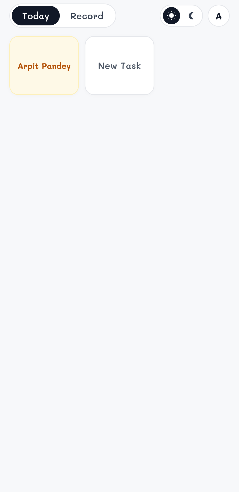 | 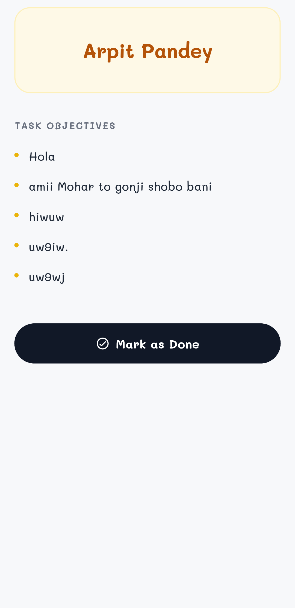 | 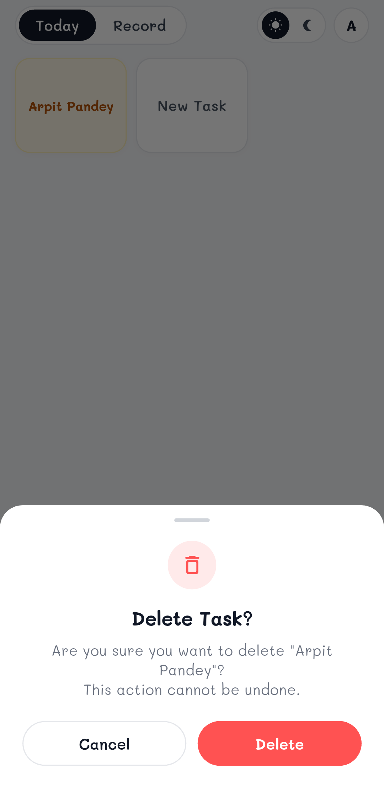 |

| ➕ Create New Task | 🗓️ Calendar Records Grid | 📅 Day Schedule Detail |
| :---: | :---: | :---: |
| 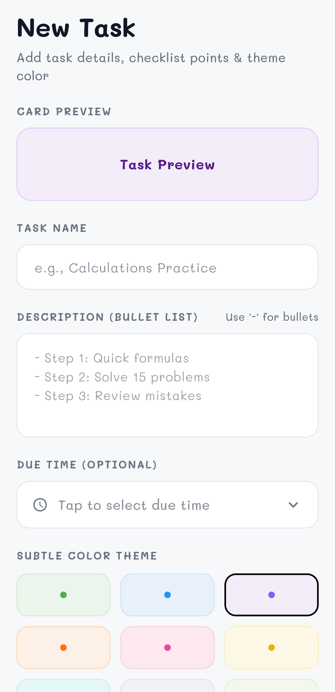 | 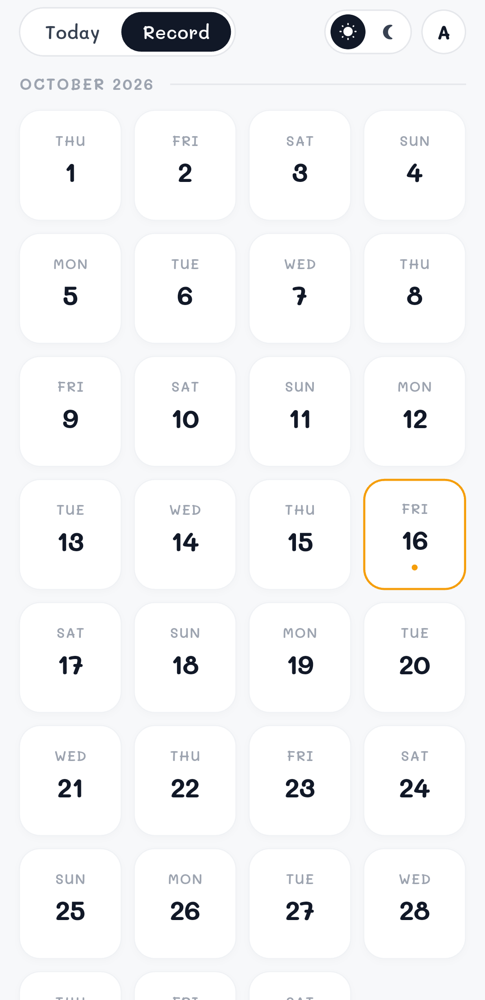 | 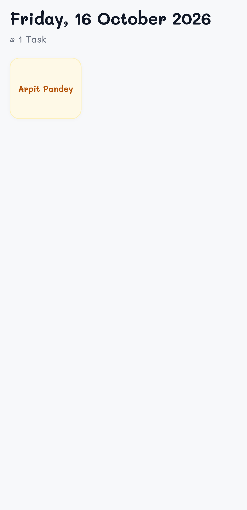 |

| 📖 Record Task Details | 👤 Profile & Statistics |
| :---: | :---: |
| 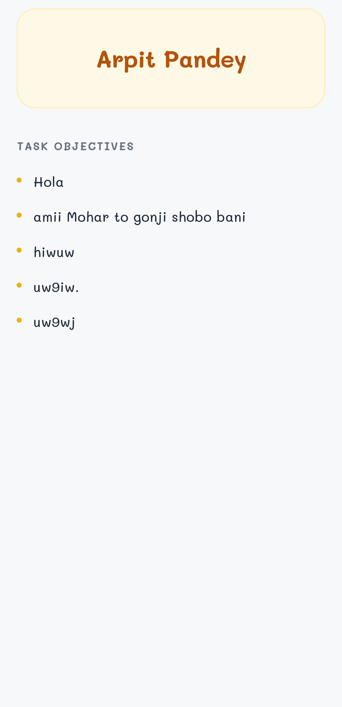 | 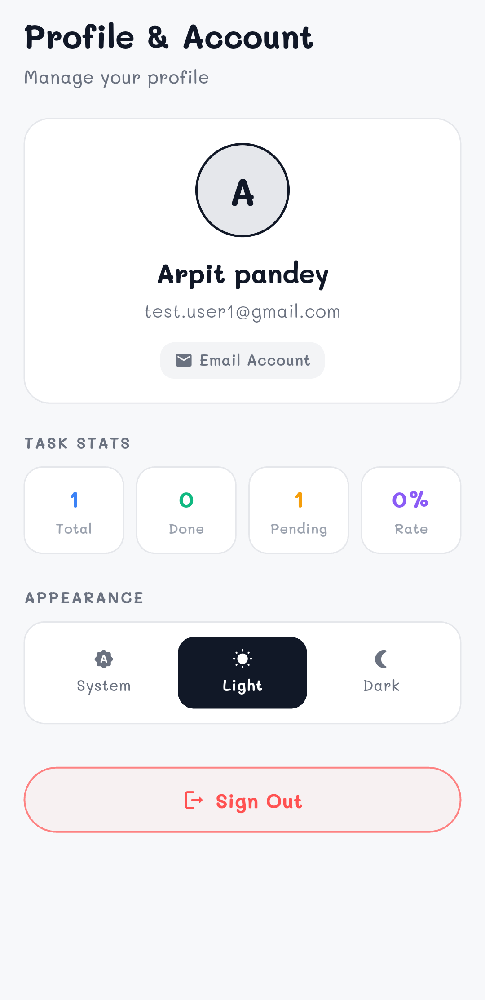 |

### 🔐 Authentication Flow

| 🔑 Sign In | 📝 Create Account | 🔒 Password Recovery |
| :---: | :---: | :---: |
| 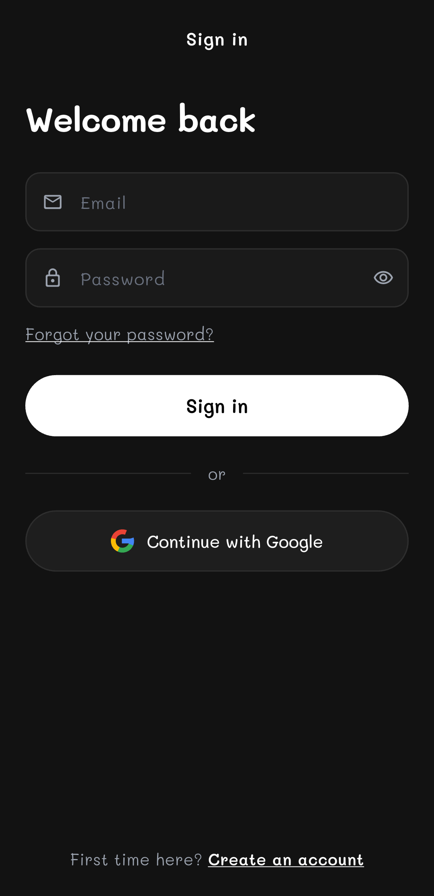 | 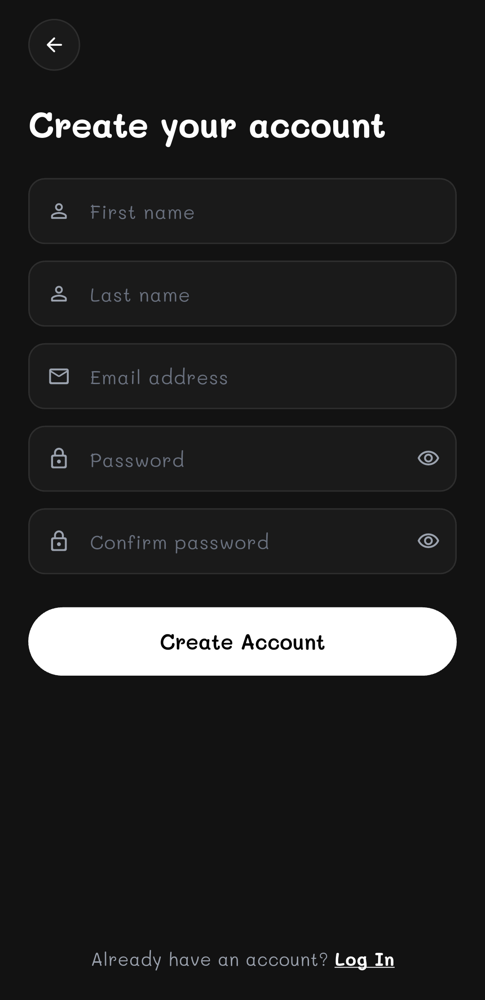 | 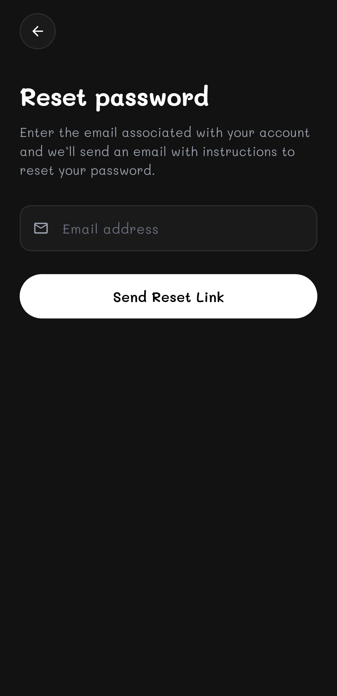 |

---

## ✨ Features

- **🎨 Minimalist Pastel & Monochrome Aesthetics**
  - Smooth light and dark theme toggle with instant persistence.
  - Distinct pastel theme palettes for custom card categorization.
  - Beautiful handwritten typography powered by `GoogleFonts.mali`.

- **📅 Calendar Records & Status Tracking**
  - Full visual monthly calendar view (October & November).
  - **Green Day Cards:** Automatically highlight days where all tasks were completed.
  - **Orange Border Cards:** Indicate days with pending tasks.
  - Tap any date to view historical tasks for that specific day without clutter.

- **⏰ Smart Due Time Selection**
  - Custom bottom sheet with quick time presets (🌅 Morning, ☀️ Afternoon, 🌇 Evening, 🌙 Night).
  - Native custom time picker option.
  - Due time chips rendered directly on task cards and details.

- **🔔 Smart Reminders & Scheduled Push Notifications**
  - High-priority background notifications triggered via `flutter_local_notifications` with system alarm wake-locks.
  - Native timezone awareness with automatic device timezone detection via `flutter_timezone`.
  - Flexible scheduling options: at due time, 15m before, 30m before, 1h before, or custom date & time.
  - Interactive reminder management directly from task detail and new task screens.
  - Auto-cleanup: Pending alarms are automatically cancelled when a task is completed or deleted.
  - Instant in-app notification test action and runtime permission management in Profile settings.


- **🔒 Authentication & Cloud Sync**
  - Google Sign-In with automatic profile picture (PFP) and display name synchronization.
  - Email & Password Sign-In and Registration with friendly validation messages.
  - Multi-provider profile linking and reactive user header avatar.

- **☁️ Cloud Firestore Persistence**
  - Realtime data sync isolated securely per user account.
  - Optimistic UI updates with instant state synchronization via Riverpod.

- **🛡️ Smart Scheduling & UX Refinements**
  - **Past Date Protection:** Prevents scheduling tasks in the past with visual warning banners.
  - **Long-Press Quick Delete:** Hold down any task card on the home screen to bring up a confirmation bottom sheet.
  - **Gesture-Based Navigation:** Back buttons removed from UI in favor of native mobile gestures.
  - **Zero Overflow Layouts:** Fully responsive across all Android device screen sizes and densities.

---

## 🛠️ Tech Stack

- **Framework:** [Flutter](https://flutter.dev/) (Dart SDK 3.x)
- **State Management:** [Flutter Riverpod](https://riverpod.dev/) 3.x
- **Backend & Auth:** [Firebase Auth](https://firebase.google.com/products/auth), [Cloud Firestore](https://firebase.google.com/products/firestore), [Google Sign-In](https://pub.dev/packages/google_sign_in)
- **Routing:** [GoRouter](https://pub.dev/packages/go_router)
- **Typography:** [Google Fonts (Mali)](https://pub.dev/packages/google_fonts)
- **Date Formatting:** [Intl](https://pub.dev/packages/intl)

---

## 🚀 Getting Started

### Prerequisites
- Flutter SDK (v3.13 or newer)
- Android SDK & Java 17
- A connected Android device or emulator

### Installation & Run

1. **Clone the repository:**
   ```bash
   git clone <your-repo-url>
   cd ToDo
   ```

2. **Install dependencies:**
   ```bash
   flutter pub get
   ```

3. **Run code analysis:**
   ```bash
   dart analyze lib
   ```

4. **Run on your device:**
   ```bash
   flutter run
   ```

5. **Build production APK:**
   ```bash
   flutter build apk --release
   ```

---

## 📁 Project Architecture

```
lib/
├── core/
│   ├── constants/       # Colors, Spacing & Dimensions
│   ├── theme/           # AppTheme (Light & Dark) & ThemeProvider
│   └── utils/           # DateUtils & Form Validators
├── features/
│   ├── auth/            # Login, Signup, Forgot Password & Auth Controller
│   ├── profile/         # Profile & Preferences Detail Screen
│   ├── schedule/        # Calendar Grids & Previous Day Records Screen
│   ├── tasks/           # New Task Screen, Task Detail Screen, Cards & Delete Sheet
│   └── today/           # Home Screen with 3-Column Task Grid
├── models/              # TaskModel, UserModel, TaskThemeColor, PriorityLevel
├── navigation/          # AppRouter & Navigation Shell
├── services/            # AuthService & FirestoreService
└── shared/              # Top Bar Header, Buttons, Snackbars & Indicators
```

---

## 📄 License
This project is licensed under the MIT License.
